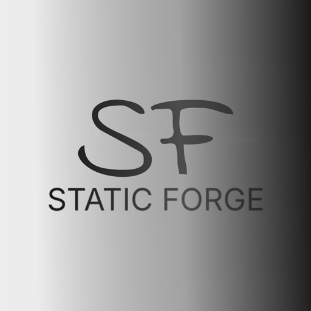

# Static Forge · staticforge.me

Web del estudio, servida con GitHub Pages desde la rama `main`. **Desplegar = hacer push.**
El dominio lo fija el archivo `CNAME` del repo (`staticforge.me`): manda sobre lo que diga
el panel de GitHub Pages, así que no hay que volver a ponerle el dominio viejo.

| Página | Qué es |
|---|---|
| `index.html` | Portada: proyectos, estudio, galería y solicitud de «Únete» |
| `i3ds.html` | Iron3D Studio |
| `fnaf-as.html` | FNAF AS |
| `linux/` | Static Linux |
| `forge-os/` | Forge OS |
| `donnies.html` | DONNIES |
| `foros.html` | Foro del estudio (API aparte, en Cloudflare Workers) |
| `solicitudes.html` | Panel de solicitudes (solo cuentas admin del foro) |

`DESIGN.md` tiene la dirección de diseño; `assets/` los estilos, los scripts y los logos de
cada proyecto.
